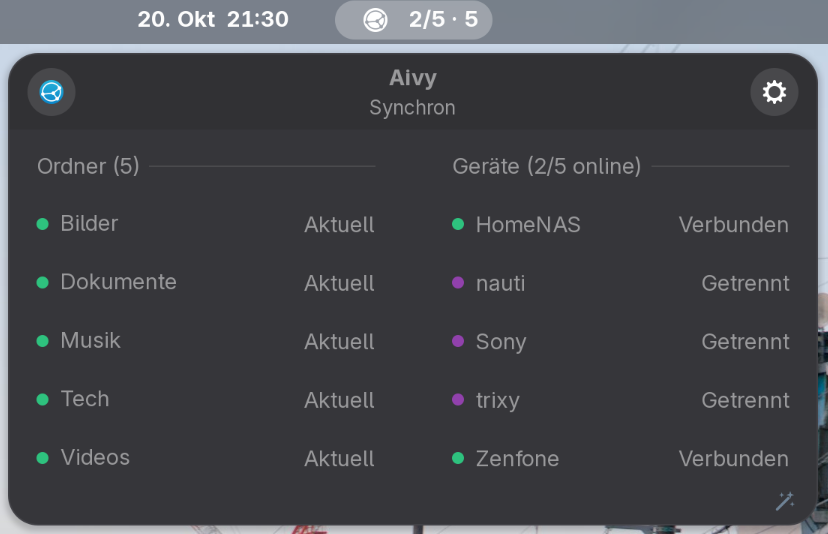
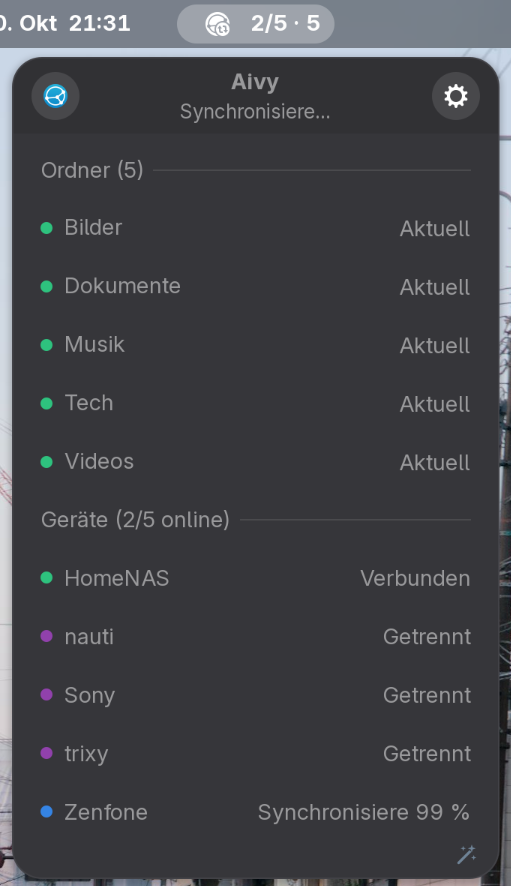

# Syncbeacon - a Gnome Shell Extension for Syncthing
   &nbsp;&nbsp;
 


Syncbeacon is a Gnome Shell Extension that shows the Syncthing status at a glance in the
GNOME top bar and opens the Syncthing web UI in its own window, like a GNOME Web app.


> _Note that this extension is NOT part of the official Syncthing project! It requires a running Syncthing instance though. To get Syncthing, check out the official site at [https://syncthing.net](https://syncthing.net)._

## Goal

This little project aims to publish this extension to the official Gnome Shell Extension Site and publish
as NixOS package as well. It runs on any distribution with GNOME Shell 49 or 50, NixOS or not.

## AI

- The refinements, testing and code review was done by human.
- The implementation and pre-tests were done be Claude Code.

## Detailed Description

- A state icon with counts, e.g. `2/5 · 5` (online/total peers · folders); a ⏸ after a count means all devices or all folders are paused. There are five states: In Sync, Synchronising…, Folder sync error or conflicts (yellow), Paused, Error with Syncthing (red). The icon turns violet when another device offers a new folder; the info box then shows the offer below its top bar with a Check button that opens the Syncthing window to accept or decline it.
- **Left click** opens an info box and refreshes the status: a slightly darker bar of controls on top (Open UI on the left, Settings on the right), with this device's name (coloured by state) and the short state between them, then every folder and every peer, stacked or side by side (see Layout in the settings); the box is at most 60 % of the screen height, longer lists scroll and a chevron at the bottom shows that more follows. Hovering the "Folders" or "Devices" headline shows a Pause/Resume button in its place that pauses or resumes all folders or all devices. Hovering a device's status shows its transfer rates or, if disconnected, when it was last seen; hovering a folder's status shows when it was last scanned. Hovering a folder's name shows buttons in its place to open the folder, pause or resume it, rescan it and edit its ignore list (`.stignore`); hovering a device's name shows a button to pause or resume that device. These hover functions are off after installing; the wand in the bottom right corner of the info box switches them on or off.
- **Left double click** opens the Syncthing window: by default the Syncthing web UI in its GNOME Web app window (created automatically if GNOME Web is installed).
- **Settings:** language (System, English, Deutsch; System picks the first system language with a translation, else English), systemd unit info with Start / Stop, Syncthing config directory, how the Syncthing window opens (the Epiphany web app, a command, or URL+Port in the default browser; the GUI URI defaults to the address in Syncthing's `config.xml`, or `http://localhost:8384` if that cannot be read), layout (position in the top bar, far left … far right, and orientation of the info box: Auto, Vertical, Horizontal; Auto puts folders and devices side by side from 10 entries on), a hotkey, and an About section with the version and a note that Syncbeacon is not part of the Syncthing project.

Design and decisions: [IMPLEMENTATION.md](PROJECT/IMPLEMENTATION.md)
Change log: [HISTORY.md](PROJECT/HISTORY.md)

## Screenshots

| Horizontal layout | Vertical layout |
|---|---|
|  |  |

## Gnome Shell Target Versions

- GNOME Shell 50 (developed on)
- GNOME Shell 49

## Layout

```
flake.nix                          package, devShell, checks (unit tests)
syncbeacon@whoozy82.github.io/     the extension
  extension.js                     wiring: client, conflicts, systemd, indicator, hotkey
  prefs.js                         settings window
  lib/state.js                     pure state rules (unit-tested)
  lib/config.js                    config.xml discovery, URI helpers
  lib/client.js                    REST snapshot + /rest/events long-poll
  lib/conflicts.js                 conflict scan via `find` subprocess
  lib/systemd.js                   unit detection, state, start/stop (D-Bus)
  lib/webapp.js                    GNOME Web app detection
  lib/i18n.js  lib/locale.js       translation lookup (unit-tested), .po loading
  locale/                          translations, one gettext `.po` file per language
  ui/indicator.js  ui/infobox.js   panel button, info box with controls
  icons/  schemas/  stylesheet.css
tests/                             gjs unit tests
scripts/                           dev-install, devkit, pack (+ po2json, ego-check), status, i18n-check, make-icons (icons from Syncthing's tray icons)
```

## Develop

```sh
nix develop
for t in tests/test_*.js; do gjs -m $t; done                 # unit tests
gjs -m scripts/i18n-check.js [--update]                     # translation keys vs. code; --update adds missing keys to the .po files
gjs -m scripts/status.js                                    # live status of the local Syncthing, read-only
scripts/dev-install.sh                                      # compile schema, symlink into ~/.local/share/gnome-shell/extensions
###
nix develop -c scripts/dev-install.sh                       # nix and script in one go
###
gnome-extensions enable syncbeacon@whoozy82.github.io       # Enable the extension
gsettings reset org.gnome.shell.extensions.syncbeacon first-run-done   # Reset the first run flag
###
scripts/devkit.sh                                           # nested GNOME Shell window for testing
nix develop -c scripts/devkit.sh                            # nested Gnome Shell w. nix
```

GNOME only loads a newly linked extension in the main session after a re-login. Use the devkit window until then. Watch for errors with:

```sh
journalctl --user -f -o cat "$(command -v gnome-shell)"      # e.g. /usr/bin/gnome-shell, on NixOS /run/current-system/sw/bin/gnome-shell
```

Without Nix, the unit tests and scripts need `gjs`, `glib-compile-schemas` and `gnome-extensions` (packages `gjs`, `glib2`/`libglib2.0-bin` and `gnome-shell`).

Disable the other Syncthing indicators while testing.

## Translations

The code uses symbolic keys instead of texts, e.g. `_('notify.rescan-failed', {error})`. Every language, English included, lives in `syncbeacon@whoozy82.github.io/locale/<code>.po` (gettext format, read at runtime, no compiling): the key is the `msgid`, the text the `msgstr`. English (`en.po`) fills in keys that another language lacks; a key missing from `en.po` too shows as the key. GNOME's own gettext follows the language of the whole Shell, so the extension uses its own small loader to make the language selectable in the settings.

Keys are `<area>.<name>` in lowercase kebab-case, e.g. `infobox.folders` or `prefs.connection.test`; texts used in several places start with `common.`. To add a text: use a new key in the code, run `gjs -m scripts/i18n-check.js --update` and fill in the empty `msgstr` lines in `en.po` and the other files. For a plural, call `_n('key', n)`; the entry gets `msgstr[0]` (singular) and `msgstr[1]` (plural), with the count as `{n}`.

To add a language: copy the header of `de.po` into a new `<code>.po` (e.g. `fr.po`), set `Language` and `Language-Name` (the name shown in the settings, e.g. `Français`), run `gjs -m scripts/i18n-check.js --update` and fill in the empty `msgstr` lines, by hand or with Poedit; the English texts are in `en.po`. Placeholders like `{count}` stay as they are. Only languages with one singular and one plural form are supported. `nix flake check` fails while a key is missing or untranslated in any file.

## Install with Nix

```nix
# flake inputs; pin a release with "github:whoozy82/syncbeacon/v1.0.0"
syncbeacon.url = "github:whoozy82/syncbeacon";

# NixOS configuration
environment.systemPackages = [ inputs.syncbeacon.packages.${pkgs.system}.default ];
# and add "syncbeacon@whoozy82.github.io" to org/gnome/shell enabled-extensions
```

`nix flake check` runs the unit tests. `scripts/pack.sh` builds the zip for extensions.gnome.org: it converts the `.po` files to `.json` (extensions.gnome.org does not accept `.po` files), leaves out `version` in `metadata.json` (extensions.gnome.org sets its own) and checks the result with `scripts/ego-check.sh`.

## Requirements on other distributions

- Syncthing, run any way: as a systemd unit (system `syncthing.service` or `syncthing@<user>.service`, or user `syncthing.service`) or started otherwise. Start / Stop in the settings needs one of these units. The config is looked up in `~/.local/state/syncthing` and `~/.config/syncthing`; another directory can be set in the settings.
- Optional: GNOME Web (`epiphany`) for the Syncthing window. A web app for Syncthing is only created automatically with a natively installed GNOME Web. With GNOME Web as a Flatpak, a web app you created yourself in GNOME Web ("Install Site as Web App…") is found and used; otherwise the GUI opens in the default browser.

## Install from a release zip

Download `syncbeacon@whoozy82.github.io.shell-extension.zip` from the [latest release](https://github.com/whoozy82/syncbeacon/releases/latest), then:

```sh
gnome-extensions install --force syncbeacon@whoozy82.github.io.shell-extension.zip
# log out and in again, then
gnome-extensions enable syncbeacon@whoozy82.github.io
```


## License

[MIT](LICENSE)
