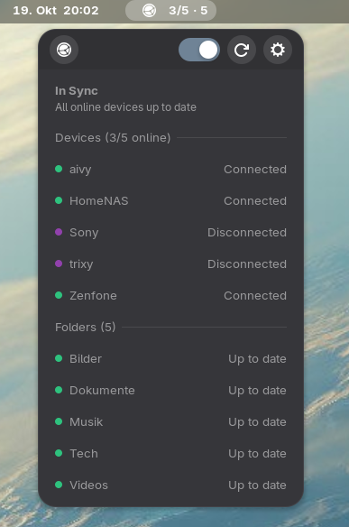

# Syncbeacon - a Gnome Shell Extension for Syncthing
   &nbsp;&nbsp;
 

```
Syncbeacon is a Gnome Shell Extension that shows the Syncthing status at a glance in the GNOME top bar and opens the Syncthing web UI in its own window, like a GNOME Web app.
```

_**This extenion is NOT part of the official Syncthing project! It requires a running Syncthing instance though. To get Syncthing, check out the offical site at [https://syncthing.net](https://syncthing.net).**_

## Goal

This little project aims to publish this extension to the official Gnome Shell Extension Site as quickly as possible.
Currently the implementation is in its infancy.

## AI

The implementation foots on agentic coding.

## Functional Description

- A state icon with counts, e.g. `2/5 · 5` (online/total peers · folders). There are five states: In Sync, Synchronising…, Folder sync error or conflicts (yellow), Paused, Error with Syncthing (red).
- **Left click** opens an info box and refreshes the status: a slightly darker bar of controls on top (Open UI on the left; Run / Pause button for all devices and folders — ▶ while running, ⏸ while paused — and Settings on the right), with this device's name (coloured by state) and the short state between them, then every folder and, below them, every peer. Hovering a device's status shows its transfer rates or, if disconnected, when it was last seen; hovering a folder's status shows when it was last scanned. Hovering the ⋯ in the middle of a folder line shows buttons to open the folder, rescan it and edit its ignore list (`.stignore`).
- **Left double click** opens the Syncthing window: by default the Syncthing web UI in its GNOME Web app window.
- **Settings:** systemd unit info with Start / Stop, Syncthing config directory, how the Syncthing window opens (a command, by default the GNOME Web app, or the GUI URI and port in the default browser), position in the top bar (far left … far right), and a hotkey.

Design and decisions: [IMPLEMENTATION.md](PROJECT/IMPLEMENTATION.md)
Change log: [HISTORY.md](PROJECT/HISTORY.md)

## Screenshot



## Gnome Shell Target Versions

- GNOME Shell 50 (developed on)

## Layout

```
flake.nix                          package, devShell, checks (unit tests)
syncbeacon@whoozy82.github.io/     the extension
  extension.js                     wiring: client, conflicts, systemd, indicator, hotkey
  prefs.js                         settings window
  lib/state.js                     pure state rules (unit-tested)
  lib/config.js                    config.xml discovery, URI helpers
  lib/client.js                    REST snapshot + /rest/events long-poll
  lib/conflicts.js                 conflict scan via `find` subprocess
  lib/systemd.js                   unit detection, state, start/stop (D-Bus)
  lib/webapp.js                    GNOME Web app detection
  ui/indicator.js  ui/infobox.js   panel button, info box with controls
  icons/  schemas/  stylesheet.css
tests/                             gjs unit tests
scripts/                           dev-install, devkit, pack, status, make-icons (icons from Syncthing's tray icons)
```

## Develop

```sh
nix develop
gjs -m tests/test_state.js && gjs -m tests/test_config.js   # unit tests
gjs -m scripts/status.js                                    # live status of the local Syncthing, read-only
scripts/dev-install.sh                                      # compile schema, symlink into ~/.local/share/gnome-shell/extensions
###
nix develop -c scripts/dev-install.sh                       # nix and script in one go
###
gnome-extensions enable syncbeacon@whoozy82.github.io       # Enable the extension
gsettings reset org.gnome.shell.extensions.syncbeacon first-run-done   # Reset the first run flag
###
scripts/devkit.sh                                           # nested GNOME Shell window for testing
```

GNOME only loads a newly linked extension in the main session after a re-login. Use the devkit window until then. Watch for errors with:

```sh
journalctl --user -f -o cat /run/current-system/sw/bin/gnome-shell
```

Disable the other Syncthing indicators while testing.

## Install with Nix

```nix
# flake inputs
syncbeacon.url = "github:whoozy82/syncbeacon";

# NixOS configuration
environment.systemPackages = [ inputs.syncbeacon.packages.${pkgs.system}.default ];
# and add "syncbeacon@whoozy82.github.io" to org/gnome/shell enabled-extensions
```

`nix flake check` runs the unit tests. `scripts/pack.sh` builds the zip for extensions.gnome.org.

